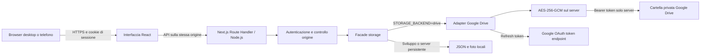
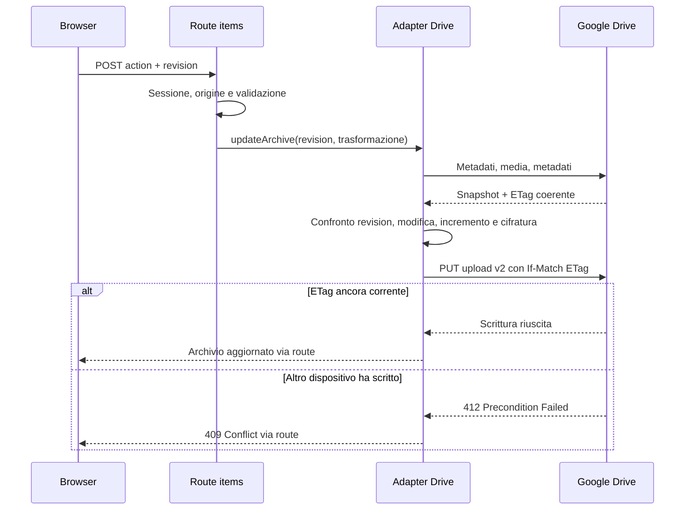

# Cose: guida dell'architettura per lo sviluppatore

Questa guida descrive il codice presente nel repository. È il punto di ingresso per modificare l'applicazione, comprendere dove risiedono i dati e gestire l'ambiente di produzione. Gli esempi contengono soltanto dati dimostrativi; i valori reali di password, token e chiavi non appartengono alla documentazione.

## Indice

1. [Scopo e decisioni principali](#1-scopo-e-decisioni-principali)
2. [Componenti e struttura del repository](#2-componenti-e-struttura-del-repository)
3. [Modello dati e ordinamento](#3-modello-dati-e-ordinamento)
4. [Interfaccia e stato React](#4-interfaccia-e-stato-react)
5. [Contratti HTTP](#5-contratti-http)
6. [Password, sessioni e autorizzazione](#6-password-sessioni-e-autorizzazione)
7. [Persistenza locale e Google Drive](#7-persistenza-locale-e-google-drive)
8. [Cifratura e confini di fiducia](#8-cifratura-e-confini-di-fiducia)
9. [Pipeline delle fotografie](#9-pipeline-delle-fotografie)
10. [Collegamento OAuth iniziale](#10-collegamento-oauth-iniziale)
11. [Configurazione e ambienti](#11-configurazione-e-ambienti)
12. [Sviluppo, GitHub e deploy](#12-sviluppo-github-e-deploy)
13. [Test e diagnosi](#13-test-e-diagnosi)
14. [Backup, ripristino e rotazione](#14-backup-ripristino-e-rotazione)
15. [Limiti e punti da mantenere sotto controllo](#15-limiti-e-punti-da-mantenere-sotto-controllo)

## 1. Scopo e decisioni principali

Cose è un archivio personale utilizzabile da desktop e telefono. Una password condivisa protegge l'intero archivio: non esistono account applicativi distinti, ruoli, registrazione, recupero password via email o separazione dei dati per utente.

Il frontend usa React e l'App Router di Next.js. Le operazioni persistenti passano da Route Handler sul runtime Node.js. In produzione l'applicazione risiede su Vercel e conserva JSON e fotografie cifrati su Google Drive. Per sviluppo o un server con disco persistente è disponibile anche un backend filesystem.

| Decisione | Conseguenza per lo sviluppatore |
| --- | --- |
| Un unico JSON per l'archivio | Ogni lettura carica tutti gli elementi; ogni modifica riscrive l'intero archivio. |
| Google Drive come storage remoto | Non occorre un database, ma latenza e quote dipendono dalle chiamate Drive. |
| Cifratura prima dell'upload | Il backend deve avere la chiave per decifrare e servire i dati. |
| OAuth solo per il collegamento del proprietario | I visitatori usano la password di Cose, senza autenticarsi con Google. |
| Revisione del JSON e scritture condizionali | Una modifica concorrente produce un conflitto anziché una sovrascrittura silenziosa. |
| Foto separate dal JSON | Il JSON contiene percorsi applicativi, non i byte delle immagini. |

Versioni dichiarate in [package.json](../package.json): Next.js `16.4.6`, React e React DOM `19.2.4`. Il progetto usa JavaScript e moduli ESM; non configura TypeScript, un ORM, uno state manager esterno o un SDK Google. Le chiamate Google usano `fetch` di Node.



## 2. Componenti e struttura del repository

| File o cartella | Responsabilità |
| --- | --- |
| [app/layout.js](../app/layout.js) | Documento HTML, lingua italiana, metadati e import del CSS globale. |
| [app/page.js](../app/page.js) | Client Component: login, card, ricerca, ordinamento, editor e galleria. |
| [app/components/photo-picker.js](../app/components/photo-picker.js) | Selezione locale o da URL, coda di foto e anteprima di ritaglio con drag e zoom. |
| [app/style.css](../app/style.css) | Layout responsive, card, modali e schermata di accesso. |
| [app/architettura/page.js](../app/architettura/page.js) | Pagina server protetta che legge questa guida dal file Markdown dopo aver verificato la sessione. |
| [app/architettura/document.js](../app/architettura/document.js) | Renderer Markdown con tabelle GFM, ancore dei titoli e diagrammi Mermaid caricati su richiesta. |
| [app/api/auth/route.js](../app/api/auth/route.js) | Stato della sessione, login e logout. |
| [app/api/items/route.js](../app/api/items/route.js) | Lettura dell'archivio e comandi CRUD/riordino. |
| [app/api/photos/route.js](../app/api/photos/route.js) | Ricezione, controllo del formato e salvataggio di una foto. |
| [app/api/photos/import/route.js](../app/api/photos/import/route.js) | Importazione autenticata da URL pubblico e normalizzazione con Sharp; restituisce un'anteprima senza persisterla. |
| [app/api/photos/[name]/route.js](../app/api/photos/%5Bname%5D/route.js) | Download autenticato di una foto. |
| [lib/auth.mjs](../lib/auth.mjs) | Password, firma della sessione, cookie, limite locale dei tentativi e controllo origine. |
| [lib/storage.mjs](../lib/storage.mjs) | Selezione del backend, persistenza locale e validazione degli elementi. |
| [lib/drive.mjs](../lib/drive.mjs) | Refresh del token, chiamate Drive, lettura coerente, aggiornamento condizionale e foto remote. |
| [lib/encryption.mjs](../lib/encryption.mjs) | Envelope AES-256-GCM con dati autenticati aggiuntivi. |
| [lib/prepare-photo.js](../lib/prepare-photo.js) | Ridimensionamento e conversione delle foto nel browser. |
| [lib/remote-image.mjs](../lib/remote-image.mjs) | Download remoto con controllo IP/DNS, connessione vincolata all'indirizzo verificato, limiti e controllo dei redirect. |
| [scripts/connect-drive.mjs](../scripts/connect-drive.mjs) | Bootstrap OAuth locale e creazione del nuovo archivio remoto. |
| [tests](../tests) | Test Node per storage, Drive simulato, cifratura e sicurezza. |
| [next.config.mjs](../next.config.mjs) | Header HTTP ed esclusioni dal tracing dei file server. |
| [vercel.json](../vercel.json) | Framework Next.js, installazione e comando di build su Vercel. |
| [.env.example](../.env.example) | Nomi delle variabili e valori esclusivamente dimostrativi. |
| [GOOGLE-DRIVE-VERCEL.md](../GOOGLE-DRIVE-VERCEL.md) | Procedura operativa di configurazione Google e Vercel. |
| [STATO.md](../STATO.md) | Ultimo stato operativo registrato; non sostituisce la verifica delle impostazioni cloud. |

La directory `data/`, i file `.env*` reali, il JSON OAuth e `.vercel/` sono locali e ignorati. `data/` non è una directory pubblica di Next.js: le immagini vengono servite dai Route Handler dopo il controllo della sessione.

La guida è disponibile anche su `/architettura`, collegata dal footer dell'archivio. È una route dinamica autenticata sul server, con esclusione dall'indicizzazione e cache privata senza conservazione. Se manca la sessione reindirizza al login con una destinazione di ritorno fissa e consentita. Il file Markdown viene incluso esplicitamente nel tracing delle funzioni Vercel, senza duplicarne il testo nel codice. Il renderer disabilita HTML grezzo; Mermaid usa modalità strict. I link relativi ai sorgenti vengono convertiti in link al repository GitHub e i collegamenti interni restano ancore della pagina.

## 3. Modello dati e ordinamento

Il contenuto logico dell'archivio, prima della cifratura, è:

```json
{
  "revision": 12,
  "items": [
    {
      "id": "e6bbe48e-a958-40c8-b7fb-f85976dd404b",
      "createdAt": "2026-11-11T10:00:00.000Z",
      "phone": "+39 000 0000000",
      "date": "2026-11-11",
      "address": "Indirizzo dimostrativo",
      "notes": "Nota di esempio",
      "websites": ["https://example.com/"],
      "photos": ["/api/photos/aaaaaaaa-bbbb-cccc-dddd-eeeeeeeeeeee.jpg"]
    }
  ]
}
```

| Campo | Vincoli effettivi |
| --- | --- |
| `revision` | Intero incrementato dopo ciascuna mutazione riuscita; è dell'intero archivio. |
| `id` | UUID generato dal server durante `create`. |
| `createdAt` | Data e ora ISO UTC generate dal server; conservate durante `update`. |
| `phone` | Stringa obbligatoria, massimo 80 caratteri. Non viene verificata la validità telefonica. |
| `date` | Stringa vuota oppure data valida nel formato `YYYY-MM-DD`; non è un timestamp. |
| `address` | Stringa obbligatoria, massimo 1.000 caratteri; nessuna geocodifica. |
| `notes` | Stringa anche vuota, massimo 20.000 caratteri. |
| `websites` | Array fino a 30 URL HTTP/HTTPS, massimo 2.000 caratteri ciascuno. Gli URL vengono normalizzati con `URL`. |
| `photos` | Array fino a 30 percorsi foto nel formato accettato da `validateItem`; i byte sono separati. |

Telefono, indirizzo e note vengono rifilati con `trim`. I campi del modello devono comunque essere presenti anche quando il loro valore consentito è vuoto. Il backend ricostruisce i campi modificabili: proprietà extra inviate dal browser non diventano automaticamente campi persistenti.

**La foto principale è `photos[0]`.** Selezionare una foto come principale la porta all'inizio dell'array; non esiste un campo `mainPhoto` separato.

**L'ordine manuale coincide con l'ordine di `items`.** Non esistono campi `position` o `sortOrder`. Gli ordinamenti per indirizzo, verifica o inserimento sono viste calcolate nel browser e non riscrivono l'ordine manuale.

Non esiste ancora un `schemaVersion` del modello applicativo né un motore di migrazione. Il campo `v` dell'envelope cifrato, descritto più avanti, identifica soltanto il formato crittografico.

## 4. Interfaccia e stato React

La pagina è un unico Client Component. I dati privati vengono richiesti dopo il controllo della sessione; non sono inseriti nel contenuto statico iniziale della pagina.

Gli stati principali sono:

| Stato | Contenuto e ciclo di vita |
| --- | --- |
| `auth` | `null` durante il controllo iniziale, poi booleano. |
| `data` | Ultima risposta completa `{revision, items}` del backend. |
| `error`, `busy` | Messaggio di errore e operazione in corso. |
| `query`, `sort` | Ricerca e ordinamento della vista; non persistiti. |
| `edit` | Bozza della scheda aperta nel modulo; `null` quando l'editor è chiuso. |
| `gallery` | Percorsi delle foto e indice dell'immagine corrente. |
| `drag` | ID della card trascinata. |

All'avvio `useEffect` chiama `GET /api/auth`; se la sessione è valida chiama `GET /api/items`. L'helper `api` converte le risposte JSON e porta `auth` a `false` su un `401` delle API dati. `run` gestisce stato occupato ed errori; `mutate` invia la revisione corrente e sostituisce `data` con l'archivio restituito dal server.

La ricerca avviene in memoria su telefono, indirizzo, note e link. Non esistono paginazione, ricerca server, polling continuo o sincronizzazione in tempo reale: per vedere modifiche da un altro dispositivo si usa il comando di ricarica o si ripete il caricamento della pagina.

Il riordino manuale è disabilitato quando è attiva una ricerca o una vista ordinata per campo. Il trascinamento inserisce l'elemento prima della card di destinazione. I pulsanti di spostamento usano lo stesso helper; vedere anche la nota sul comando di spostamento verso il basso nella sezione dei limiti.

Il logout cancella lo stato visibile e il cookie del browser corrente. Il modulo di modifica viene chiuso solo dopo una mutazione riuscita; un errore di conflitto non realizza una fusione automatica tra bozza e archivio remoto.

## 5. Contratti HTTP

Le API sono sulla stessa origine della pagina. Tutti i Route Handler usano il runtime Node.js. Gli endpoint dati e foto dichiarano `maxDuration = 60`; l'effettiva esecuzione resta soggetta alla configurazione dell'hosting.

### 5.1 Sessione

| Metodo e percorso | Richiesta | Risposta |
| --- | --- | --- |
| `GET /api/auth` | Nessun body; cookie facoltativo. | `200 {"authenticated": true/false}`. |
| `POST /api/auth` | JSON `{ "password": "valore fornito dall'utente" }` e origine valida. | `200 {"ok":true}` e cookie, oppure `401`, `403`, `503`. |
| `DELETE /api/auth` | Origine valida. | `200 {"ok":true}` e cookie con scadenza immediata. |

### 5.2 Archivio

`GET /api/items` richiede una sessione valida e restituisce l'intero archivio. Tutte le mutazioni usano **POST sullo stesso endpoint**, con un campo `action`; non sono implementate route REST separate `PUT /items/:id` o `DELETE /items/:id`.

```json
{
  "action": "create",
  "revision": 12,
  "item": {
    "phone": "+39 000 0000000",
    "date": "",
    "address": "Indirizzo dimostrativo",
    "notes": "",
    "websites": [],
    "photos": []
  }
}
```

| `action` | Altri campi richiesti | Effetto |
| --- | --- | --- |
| `create` | `revision`, `item` | Aggiunge in coda un elemento con ID e data di creazione server. |
| `update` | `revision`, `id`, `item` | Sostituisce i campi modificabili, preservando ID e data di creazione. Un ID inesistente genera un errore di validazione. |
| `delete` | `revision`, `id` | Filtra l'elemento dal JSON; un ID inesistente non genera errore dedicato. |
| `reorder` | `revision`, `ids` | Sostituisce l'ordine. `ids` deve essere una permutazione completa degli ID presenti, senza duplicati. |

Ogni mutazione riuscita restituisce `{revision, items}` aggiornato. Anche un comando che lascia invariata la lista, come una cancellazione su ID inesistente, attraversa il percorso di aggiornamento e incrementa la revisione.

### 5.3 Fotografie

| Metodo e percorso | Contratto |
| --- | --- |
| `POST /api/photos` | `multipart/form-data`, campo `photo`; sessione e origine obbligatorie. Restituisce `{ "url": "/api/photos/<uuid>.<estensione>" }`. |
| `POST /api/photos/import` | JSON `{ "url": "https://sito.example/immagine.jpg" }`, sessione e origine obbligatorie. Restituisce byte JPEG per l'editor oppure un errore JSON. Non salva ancora la foto. |
| `GET /api/photos/[name]` | Sessione obbligatoria; nome ristretto a UUID/caratteri esadecimali con estensione `jpg`, `png` o `webp`. Restituisce i byte e il MIME appropriato. |

Non si restituisce un link pubblico Google Drive. Un upload riuscito non aggiunge automaticamente la foto a una scheda: il frontend inserisce il percorso nella bozza e deve poi salvare l'elemento.

### 5.4 Errori e cache

| Stato | Significato nel contratto corrente |
| --- | --- |
| `400` | Richiesta, azione, campo o formato non valido. |
| `401` | Sessione assente/scaduta o login non riuscito; il limite locale dei login restituisce anch'esso `401`. |
| `403` | Origine non autorizzata per una mutazione. |
| `404` | File remoto mancante, foto inesistente o foto remota non privata. |
| `409` | Revisione applicativa superata o precondizione ETag non soddisfatta. |
| `413` | Limite dimensionale controllato dall'applicazione. |
| `429` | Risposta prevista dal firewall distribuito, quando la relativa regola è attiva. |
| `503` | Configurazione mancante, errore Drive o impossibilità di decifrare. |

Molti errori hanno un body JSON `{ "error": "messaggio" }`, ma i rifiuti anticipati di autenticazione/origine e gli errori del download foto possono avere body vuoto. Non assumere che ogni risposta sia JSON. Il proxy di hosting può inoltre produrre errori propri.

Gli endpoint API usano `Cache-Control: private, no-store` tramite gli header globali e, in diversi casi, gli header della route. La cartella pubblica del frontend non contiene dati dell'archivio.

## 6. Password, sessioni e autorizzazione

La password risiede nella variabile server `ARCHIVE_PASSWORD`; non esiste una tabella di utenti. Il confronto usa `scryptSync` su entrambe le stringhe con salt casuale per processo e `timingSafeEqual`. Il salt non viene persistito perché il controllo confronta la password ricevuta con il valore configurato, non con un hash memorizzato in un database.

La sessione è stateless:

```text
archive-session = scadenzaEpochMs.firmaHex
firmaHex = HMAC-SHA256(SESSION_SECRET, scadenzaEpochMs + NUL + ARCHIVE_PASSWORD)
```

La scadenza è fissata a sette giorni. Il cookie è HttpOnly e SameSite=Strict, con Secure forzato quando è presente `VERCEL` oppure abilitato tramite `COOKIE_SECURE=true`. `authorized` verifica formato, scadenza e firma a ogni chiamata protetta.

Cambiare password o `SESSION_SECRET` invalida le firme precedenti. Il logout elimina soltanto il cookie del browser: non esiste una lista di sessioni revocate sul server e non si può revocare un singolo token copiato senza ruotare password o segreto.

Le mutazioni richiedono anche un controllo di origine. Quando `APP_ORIGIN` è configurata viene confrontata l'origine completa, inclusi protocollo e porta. Su Vercel, l'assenza di `APP_ORIGIN` blocca le mutazioni. Soltanto fuori da Vercel, in sua assenza, si confrontano `Origin.host` e `Host`. Quindi il valore di esempio `http://localhost:3000` non autorizza automaticamente un telefono che usa l'IP del PC o un dominio alternativo.

Il limite in memoria è globale per istanza: massimo dieci tentativi di login nella finestra di un minuto, azzerati da un login corretto o dalla scadenza della finestra. Non è un contatore distribuito né per IP. Il firewall Vercel deve fornire il limite distribuito su `POST /api/auth`. Nell'ultimo stato registrato la regola è in bozza e la pubblicazione richiede ancora l'approvazione umana prevista da Vercel.

Gli header globali disabilitano l'inquadramento in frame, il MIME sniffing, la trasmissione del referrer e alcune funzionalità del browser. La CSP attuale limita frame ancestors, base URI, oggetti e destinazioni dei form; non costituisce una policy completa di allowlist per script e connessioni.

## 7. Persistenza locale e Google Drive

### 7.1 Facade comune

`lib/storage.mjs` espone:

```text
readArchive() -> Promise<{revision, items}>
updateArchive(revision, transformItems) -> Promise<{revision, items}>
writePhoto(name, bytes) -> Promise<void>
readPhoto(name) -> Promise<Buffer>
validateItem(input) -> elemento normalizzato oppure errore
```

Soltanto `STORAGE_BACKEND=drive` seleziona Drive. In assenza di tale valore si usa il backend locale, ma la presenza di `VERCEL` fa rifiutare questa modalità. Per un nuovo adapter conviene conservare l'interfaccia e gli errori `status` previsti dalle route.

### 7.2 Backend locale

La directory è risolta da `DATA_DIR`, con default `./data`. `items.json` mancante equivale a `{revision:0,items:[]}`; JSON corrotto e altri errori non vengono convertiti in archivio vuoto.

Una coda di Promise serializza le scritture nello stesso processo. Dentro la coda si legge il JSON, si controlla `revision`, si applica la trasformazione e si scrive un file temporaneo UUID, poi rinominato su `items.json`. Le foto sono salvate in `photos/`.

**Questa modalità conserva dati e foto in chiaro sul disco.** La cifratura applicativa è implementata nell'adapter Drive, non nella facade. La coda locale non coordina processi differenti e il rename non è una transazione fra JSON e immagini.

### 7.3 Token Google e chiamate remote

L'adapter usa il refresh token per ottenere un access token da `https://oauth2.googleapis.com/token`. L'access token è memorizzato soltanto nell'istanza Node e riutilizzato finché resta valido per oltre un minuto. Una Promise condivisa evita refresh simultanei nella stessa istanza; istanze Vercel diverse hanno cache indipendenti.

Il refresh ha timeout di 20 secondi; le richieste Drive hanno timeout di 25 secondi. Non è implementato un retry generale con backoff per errori di rete, quote o `429`. Un `401` Drive elimina il token in cache, ma la richiesta fallita non viene ripetuta automaticamente. I dettagli della risposta Google non vengono riversati nei messaggi pubblici.

### 7.4 Lettura coerente

Per leggere il JSON remoto:

1. Caricare i metadati v2: ETag, parent, MIME, stato di cestinamento e condivisione.
2. Verificare parent configurato, MIME `application/json`, file non cestinato e `shared === false`.
3. Scaricare il contenuto cifrato con `alt=media`.
4. Rileggere i metadati.
5. Se l'ETag è cambiato, riprovare lo snapshot, fino a tre tentativi.
6. Decifrare, fare parsing del JSON e verificare almeno revisione intera e array `items`.

Il controllo fra due letture impedisce di associare intenzionalmente il contenuto a una versione diversa dei metadati. Le ulteriori proprietà degli elementi non sono rivalidate integralmente durante la lettura.

### 7.5 Scrittura e conflitti



I due controlli risolvono problemi diversi: `revision` rileva la bozza basata su dati già superati; `If-Match` copre la finestra fra lettura e scrittura, anche fra istanze serverless senza memoria condivisa. Non rimuovere l'header condizionale sostituendolo con il solo controllo nel processo.

La dimensione dell'envelope JSON cifrato in scrittura è limitata a 4 MiB. L'upload usa Drive API v2 per il percorso ETag; le fotografie usano v3 per creazione e ricerca. Non sostituire v2 con v3 senza verificare di nuovo le precondizioni reali e i relativi test.

Il contenuto remoto dell'archivio è `items.encrypted.json`. Le foto hanno un nome logico UUID con estensione, un file remoto `<nome-logico>.encrypted` e MIME `application/octet-stream`. Sono ricercate nella cartella configurata tramite `appProperties` `app=cose`, `kind=photo` e `name=<nome-logico>`. Un risultato assente, ambiguo, condiviso o con MIME diverso viene rifiutato. Gli ID Drive delle foto non fanno parte del modello restituito al browser.

## 8. Cifratura e confini di fiducia

`ARCHIVE_ENCRYPTION_KEY` deve decodificare da base64 in esattamente 32 byte. Per ogni cifratura si genera un IV casuale di 12 byte. L'envelope serializzato è:

```json
{
  "v": 1,
  "iv": "<base64>",
  "tag": "<base64>",
  "ciphertext": "<base64>"
}
```

AES-256-GCM verifica l'integrità durante la decifratura. I dati autenticati aggiuntivi (AAD) sono `cose:archive` per il JSON e `cose:photo:<nome-logico>` per una fotografia. Questo lega il contenuto al suo contesto e rende non valido, per esempio, lo scambio fra due foto con nomi diversi.

| Ambiente | Cosa può vedere |
| --- | --- |
| Browser autenticato | Contatti e immagini decifrati; nessun token Google o chiave applicativa. |
| Backend Vercel | Segreti configurati e dati in chiaro durante elaborazione e risposta. |
| Google Drive | File cifrati, dimensioni, nomi tecnici e metadati necessari allo storage. |
| Repository Git | Codice, documentazione e template di configurazione senza valori reali. |

Questa è cifratura sul server prima dello storage remoto, **non cifratura end-to-end rispetto a Vercel**. Chi controlla il backend o le sue variabili può decifrare. Non elimina inoltre il rischio di compromissione di un browser autenticato.

Lo scope OAuth `drive.file` limita i file accessibili in base alla concessione Google e all'app; non è uno scope Google definito per una singola cartella. I controlli sul parent e sui metadati della cartella sono restrizioni applicative aggiuntive. Non aggiungere chiamate per creare permessi pubblici o esporre Bearer token al browser per servire le immagini.

## 9. Pipeline delle fotografie

Nel browser `preparePhoto`:

1. Accetta MIME JPEG, PNG o WebP; rifiuta un originale oltre 25 MiB.
2. Decodifica con `createImageBitmap`.
3. Riduce il lato maggiore a massimo 2.000 pixel, senza ingrandire foto più piccole.
4. Disegna su canvas con sfondo bianco, quindi la trasparenza viene appiattita.
5. Produce JPEG provando qualità `0.88`, `0.75`, `0.6`, `0.4`, fino a ottenere un file non superiore a 3 MiB.
6. Invia una foto per richiesta; gli upload multipli sono sequenziali.

Prima di questi passaggi il componente `PhotoPicker` mostra la foto con `react-easy-crop`. L'utente può trascinarla, regolare lo zoom da 1 a 4, scegliere rapporto 3:2, quadrato o originale e usare Ricentra. I pixel del ritaglio vengono passati a `preparePhoto(file, crop)`, che controlla i limiti della selezione e disegna solo quell'area sul canvas. Il ritaglio viene aperto con un portal in una finestra dedicata, esterna al contenitore scorrevole della scheda. Titolo e barra di conferma restano fuori dall’area centrale scorrevole; il pulsante di conferma rimane visibile anche su schermi bassi. Il contenitore della scheda sottostante viene reso inert durante il ritaglio, con gestione del focus e del tasto Escape. Il pulsante “Usa questa immagine” avvia l'upload; fino alla conferma o all'annullamento il salvataggio della scheda è disabilitato. Una selezione multipla viene inquadrata e confermata una foto per volta.

Il contenuto caricato è la nuova immagine canvas, non l'originale: il frontend non conserva i metadati originali o un backup della foto sorgente. HEIC locale non è supportato direttamente.

### Importazione da un sito web

Il browser invia il link diretto a `POST /api/photos/import`. Il server accetta soltanto HTTP/HTTPS su porte standard, senza credenziali nell'URL. Verifica che tutti gli indirizzi DNS restituiti siano pubblici, blocca loopback, reti private, link-local, indirizzi riservati e corrispondenti forme IPv4-mapped. La connessione usa l'IP già verificato tramite un lookup personalizzato: non effettua una seconda risoluzione DNS non controllata. Ogni redirect viene validato nuovamente, fino a tre reindirizzamenti; non vengono inoltrati cookie o token dell'utente.

Il download ha un budget di 20 secondi e un limite di 15 MiB. Sharp controlla e decodifica l'immagine con un limite di 40 milioni di pixel, applica l'orientamento e la normalizza in JPEG fino a 2000 pixel e 3 MiB. I formati remoti ammessi dal decoder includono JPEG, PNG, WebP, GIF (primo fotogramma) e HEIF/AVIF quando supportati dalla build Sharp. SVG e pagine HTML non vengono restituiti all'editor. L'anteprima usa un object URL locale, che viene revocato quando non serve più; l'utente deve ancora scegliere l'inquadratura e confermare il caricamento su Drive. Alcuni siti possono vietare il download: in tal caso occorre salvare la foto sul dispositivo e caricarla come file.

Il server controlla dimensione e firme iniziali JPEG/PNG/WebP; non effettua una decodifica completa o una seconda ricompressione. Un client API diverso dall'interfaccia può quindi caricare PNG/WebP e immagini con metadati: la rimozione dei metadati non è una garanzia del backend per tutti i client possibili.

In Drive i byte vengono cifrati prima del multipart upload. Il download cerca il file privato, scarica l'envelope, lo decifra e invia una `ReadableStream` al browser. La risposta è uno stream HTTP, ma il backend ha già caricato e decifrato l'intera immagine in memoria: non è streaming crittografico incrementale.

Foto e archivio non sono aggiornati in un'unica transazione. Annullare un editor dopo l'upload, rimuovere una foto o eliminare una scheda può lasciare un file non referenziato. Attualmente non è presente garbage collection automatica.

## 10. Collegamento OAuth iniziale

Lo script `connect-drive.mjs` è uno strumento amministrativo locale, non una route del sito pubblicato. Legge ID e secret dalle variabili di ambiente oppure dalla proprietà `web` del JSON locale `.google-oauth-client.json`. Gli endpoint Google sono costanti del codice; non vengono presi liberamente dal file delle credenziali.

Il callback consentito è esattamente:

```text
http://127.0.0.1:53682/oauth/callback
```

Il server ascolta solo su loopback, verifica host, path e metodo, usa `state` casuale, PKCE S256 e scade dopo dieci minuti. Il proprietario esegue personalmente login e consenso nel browser. La richiesta usa soltanto `drive.file`, `access_type=offline` e `prompt=consent`.

Dopo lo scambio del codice lo script crea una cartella privata, verifica proprietà e condivisione, crea il JSON vuoto cifrato e prova sul servizio reale che riutilizzare un ETag superato dia `412`. Solo al completamento salva `.env.drive.local` senza stampare segreti.

Lo script rifiuta di sovrascrivere una configurazione `.env.drive.local` esistente. È un bootstrap di **un nuovo archivio**, non uno strumento di riparazione o riconnessione automatica. Un errore intermedio può lasciare una cartella remota creata; non rilanciarlo indiscriminatamente per risolvere un problema su dati esistenti. `.env.drive.local` non è un nome caricato automaticamente da Next.js: i suoi valori vanno trasferiti in `.env.local` o nelle variabili server dell'ambiente previsto.

Per la configurazione della console Google, lo stato del consenso e la possibile scadenza dei token di test vedere la [guida operativa](../GOOGLE-DRIVE-VERCEL.md).

## 11. Configurazione e ambienti

| Variabile | Dove serve | Significato |
| --- | --- | --- |
| `ARCHIVE_PASSWORD` | Tutti | Password dell'archivio; almeno 16 caratteri richiesti su Vercel. |
| `SESSION_SECRET` | Tutti | Segreto HMAC, almeno 32 caratteri. |
| `STORAGE_BACKEND` | Tutti | `drive` per remoto; usare esplicitamente `local` per il filesystem. |
| `APP_ORIGIN` | Produzione e origini fisse | Origine esatta autorizzata per le mutazioni, senza percorsi. |
| `DATA_DIR` | Backend locale | Directory del JSON e delle foto, risolta rispetto alla directory di esecuzione se relativa. |
| `COOKIE_SECURE` | Server HTTPS fuori Vercel | `true` per cookie Secure; su Vercel Secure è comunque forzato. |
| `GOOGLE_CLIENT_ID` | Drive | Identificatore del client OAuth dedicato. |
| `GOOGLE_CLIENT_SECRET` | Drive | Segreto del client, solo server. |
| `GOOGLE_REFRESH_TOKEN` | Drive | Concessione offline del proprietario, solo server. |
| `GOOGLE_DRIVE_FOLDER_ID` | Drive | Cartella privata creata nel bootstrap. |
| `GOOGLE_DRIVE_ARCHIVE_ID` | Drive | File JSON cifrato da leggere e aggiornare. |
| `ARCHIVE_ENCRYPTION_KEY` | Drive | Chiave base64 da 32 byte; deve corrispondere ai dati esistenti. |
| `VERCEL` | Fornita dall'hosting | Attiva i controlli che impediscono storage locale e cookie non Secure. |

Non usare prefissi `NEXT_PUBLIC_` per queste credenziali. I file `.env` reali non devono comparire nel commit o nel pacchetto di deploy. `.env.example` è l'unico template `.env` previsto in Git.

Per sviluppo quotidiano usare un archivio di test separato. Copiare la configurazione Drive di produzione nel proprio `.env.local` significa operare sugli stessi dati reali dal computer: non esiste una separazione automatica per hostname o branch Git.

Gli ambienti Vercel Production e Preview devono avere credenziali, chiave, archivio e origine coerenti e separati. Il codice non imposta la configurazione cloud del progetto né le regole WAF tramite `vercel.json`.

## 12. Sviluppo, GitHub e deploy

### Avvio di un checkout nuovo

Usare Node 22 o superiore per il flusso di sviluppo documentato e mantenere `package-lock.json` versionato:

```powershell
npm ci
Copy-Item .env.example .env.local
# Compilare .env.local localmente, senza usare i segnaposto come password.
npm run dev
```

Non eseguire `Copy-Item` sopra una configurazione esistente che si vuole conservare. Per un nuovo archivio locale bastano configurazione della password, segreto di sessione e `STORAGE_BACKEND=local`; i valori Google possono restare vuoti.

Gli script `dev` e `start` ascoltano su `0.0.0.0`. Per provare da telefono usare l'IP del computer sulla stessa rete, adattare `APP_ORIGIN` a quell'origine o usare il fallback locale senza `APP_ORIGIN`, e autorizzare il traffico nel firewall del computer se necessario. Questa modalità HTTP locale non sostituisce HTTPS in produzione.

### Controlli e pubblicazione

```powershell
npm test
npm run build
git diff --check
git status --short
```

I test usano dati temporanei o un Drive simulato. La build non deve essere usata per creare o riconfigurare archivi remoti.

Il repository remoto del progetto è `bennibeni/cose`. Se Vercel è collegato a questo repository, il branch di produzione configurato nel dashboard determina quali push causano una pubblicazione; il collegamento `origin` locale, da solo, non dimostra che l'integrazione Vercel sia attiva. Per deploy manuale si può usare la CLI autenticata:

```powershell
npx vercel --prod
```

Vercel esegue `npm ci` e `npm run build` con preset Next.js. Le variabili server Production devono essere configurate prima del deploy; una modifica alle variabili richiede un nuovo deploy. Il codice non pubblica da solo una modifica alle regole firewall.

Le esclusioni si trovano in tre livelli:

| File | Protegge da |
| --- | --- |
| `.gitignore` | Aggiunta ordinaria dei file locali a Git; non rimuove file già tracciati. |
| `.vercelignore` | Upload CLI di configurazioni, dati e script amministrativi locali. |
| `outputFileTracingExcludes` in Next.js | Inclusione di segreti e dati locali nei bundle delle funzioni server. |

Prima di un commit usare anche `git ls-files` e `git check-ignore` sui file sensibili. Se un segreto è già stato pubblicato, ignorarlo dopo non annulla l'esposizione: revocarlo/ruotarlo e valutare la bonifica della cronologia.

### Regola per aggiornare questa guida

Una modifica al modello, ai payload API, alle variabili richieste, alla sessione o al formato cifrato deve aggiornare questa guida e il template `.env.example` quando pertinente. Non aggiungere dettagli tecnici dell'infrastruttura alle schermate rivolte all'utilizzatore dell'archivio.

## 13. Test e diagnosi

| Test | Cosa copre |
| --- | --- |
| `tests/storage.test.mjs` | Persistenza locale, controllo della revisione, validazione e firma della sessione. |
| `tests/drive.test.mjs` | Adapter con fetch simulato, istanze concorrenti, foto cifrate, errori, file condivisi e integrità AES-GCM. |
| `tests/security.test.mjs` | Origine esatta, cookie Secure su Vercel e rifiuto del filesystem in produzione. |
| `tests/remote-image.test.mjs` | Blocco di indirizzi interni e URL non consentiti, risposte DNS miste, redirect, DNS rebinding e limiti del download. |

`npm test` usa `node --test`; non richiede l'account Google reale e non sostituisce i controlli del servizio. Lo script di bootstrap verifica realmente la precondizione ETag sul nuovo archivio. Sono state inoltre eseguite verifiche HTTP in produzione per login, CRUD e foto, ma non esiste uno script E2E browser versionato né una pipeline CI dichiarata nel repository.

| Sintomo | Verifica iniziale |
| --- | --- |
| Login o salvataggio risponde `403` | Confrontare protocollo, hostname e porta del browser con `APP_ORIGIN`; controllare di aver ridistribuito le variabili corrette. |
| Login corretto ma richieste dati `401` | Controllare invio del cookie, scadenza, eventuale rotazione della password e uso di HTTPS con cookie Secure. |
| Archivio risponde `503` | Controllare presenza delle variabili, validità del refresh token, file privato nel parent corretto, chiave e disponibilità Drive. |
| Errore di decifratura | Recuperare la chiave corretta e il contesto del file; non generare una nuova chiave per tentativi sullo stesso archivio. |
| Salvataggio `409` | Rileggere l'archivio e riapplicare consapevolmente la modifica. Non disabilitare il controllo di revisione. |
| Upload `400` o `413` | Controllare formato, firma dei byte e dimensioni; convertire HEIC prima di usare il flusso UI. |
| Foto `404` su Drive | Controllare nome logico, appProperties, parent, unicità del risultato e assenza di condivisioni. |
| Login `429` | Controllare la regola distribuita WAF e attendere la finestra prevista; non riprovare in ciclo. |

Nei log registrare percorso applicativo, esito, durata e identificativi tecnici strettamente necessari. Non registrare body di login, header Cookie/Authorization, contenuto del JSON decifrato, refresh token o chiavi. L'implementazione non include ancora un sistema strutturato di audit o metriche applicative.

## 14. Backup, ripristino e rotazione

### Backup e ripristino

Per il backend locale, fermare il processo e copiare l'intera `DATA_DIR`; per ripristinare, configurare il percorso che contiene `items.json` e `photos/`.

Per Drive occorre conservare insieme, ma con accessi protetti, archivio cifrato, file foto cifrati, chiave e configurazione che identifica l'archivio. La sola copia del codice o del JSON senza chiave non recupera i dati. La cronologia del codice Git non è un backup dei contenuti dell'app.

Il nome logico della foto deve rimanere identico perché è parte dell'AAD. Se si copiano i file in una nuova cartella Drive, vanno mantenute le `appProperties` delle foto e aggiornati gli ID configurati; una semplice ricarica manuale che perde i metadati non è un ripristino completo. Il nuovo client OAuth deve anche essere autorizzato a quei file: avere un ID non aggira lo scope `drive.file`.

Il repository non contiene ancora un comando di export/import, backup schedulato o migrazione fra cartelle/client. Pianificare e verificare un ripristino in ambiente separato prima di modificare la configurazione del solo archivio esistente. Evitare scritture durante una copia che deve rappresentare uno snapshot coerente.

### Rotazione e revoca

| Credenziale | Procedura da rispettare |
| --- | --- |
| Password o `SESSION_SECRET` | Aggiornare le variabili dell'ambiente e ridistribuire; tutte le sessioni precedenti diventano invalide. |
| Client secret Google | Aggiornare la variabile sul backend e verificare il refresh prima di disattivare il vecchio secret. Non serve cambiare la chiave dei dati. |
| Refresh token | Sostituirlo tramite un flusso amministrativo OAuth per lo stesso client/account e accesso ai file esistenti; il bootstrap corrente crea invece un archivio nuovo e non gestisce questa migrazione. |
| Chiave AES | Decifrare con la vecchia chiave e ricifrare archivio e foto con la nuova, preservando i contesti; non basta cambiare la variabile. Non c'è ancora uno script di rotazione. |

Per interrompere l'accesso Google revocare l'app dal relativo Account Google e rimuovere il refresh token dall'ambiente server. La revoca non cancella automaticamente i file dal Drive del proprietario.

## 15. Limiti e punti da mantenere sotto controllo

- **Dimensioni e prestazioni:** niente paginazione o caricamento incrementale. Ogni snapshot normale del JSON richiede tre chiamate Drive, oltre all'eventuale refresh; ogni mutazione aggiunge almeno l'upload. La dimensione totale dell'archivio cresce con tutti gli elementi.
- **Concorrenza:** nessuna fusione automatica dei campi e nessuna transazione fra JSON e file foto. Il filesystem locale richiede un singolo processo. Le scritture Drive dipendono dalla precondizione ETag verificata nel bootstrap.
- **Riordino verso il basso:** `move(id, target)` inserisce prima di `target`; invocarlo indicando il successivo immediato, come fa attualmente il pulsante `↓`, può lasciare invariato l'ordine. È un punto di manutenzione del codice corrente, non un ordinamento con semantica distinta già implementato.
- **Bozze e sincronizzazione:** ricaricare non fonde la bozza con eventuali modifiche altrui. Non sono presenti collaborazione in tempo reale, storico delle modifiche visibile o autosalvataggio.
- **File non referenziati:** l'eliminazione applicativa toglie i riferimenti dal JSON ma non elimina automaticamente le immagini remote. Una futura pulizia deve distinguere upload in corso e foto ancora referenziate.
- **Sicurezza operativa:** il WAF è configurazione cloud separata dal codice e va verificato; la sessione non ha revoca per singolo dispositivo. La password dell'app è un segreto server e protegge un unico archivio condiviso.
- **Controlli dei file:** le firme iniziali non sostituiscono una decodifica robusta sul server. Il controllo dei metadati Drive e il successivo download sono chiamate distinte; non sono un'operazione atomica con eventuali cambi di condivisione fatti da altri strumenti.
- **Robustezza:** non esistono retry generali, recovery transazionale, audit strutturato, validazione completa dello schema in lettura o migrazioni automatiche. Alcuni errori di parsing/schema possono essere classificati genericamente dalle route: verificare lo status reale prima di basare un client su un caso non documentato.

Per aggiungere nuovi campi partire da `validateItem`, dal modulo React e dal contratto HTTP; definire come leggere i record precedenti e aggiornare i test pertinenti. Per superare la scala di un piccolo archivio personale, introdurre un modello con migrazioni, paginazione e storage transazionale prima di ampliare gli accessi a più utenti.
